## 🛠 Tech Stack

| Category | Technologies |
| :--- | :--- |
| **Languages** |   |
| **Frontend** |    |
| **AI / ML** |    |
| **Test Automation** |    |
| **CI/CD & Monitoring** |   |
| **Database & API** |   |
| **Tools** |    |

## 📊 GitHub Stats

  
  

## 🏆 Algorithm

  
  

# commit rule
* commit title
  * solve / fail : 알고리즘 문제를 해결하거나 해결하지 못한 경우
  * study : 새로운 file을 생성하여 공부한 것을 정리하는 경우
  * update : README 등의 file 또는 file name을 수정하는 경우
  * refactoring : file의 위치를 바꾸는 경우
  * others : 상단의 title에 해당되지 않는 경우
* commit description
  * 최대한 간결하고 무엇을 했는지 알 수 있도록 적을 것
  * 여러 file이 동시에 commit 찍히지 않도록 문제/공부 또는 수정한 내용을 단위로 commit을 작성할 것
 
# Views

